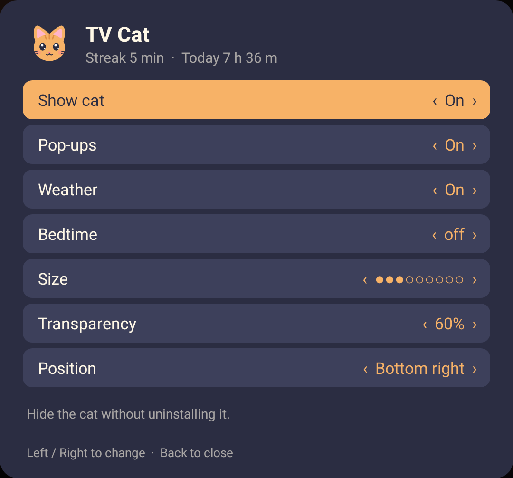
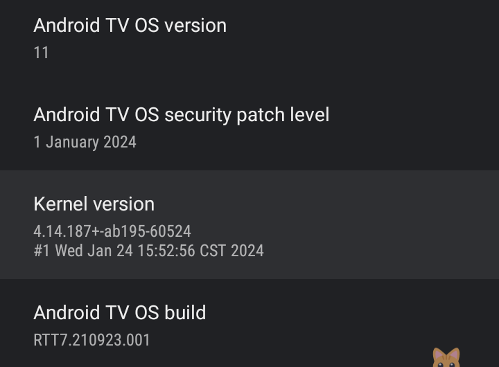
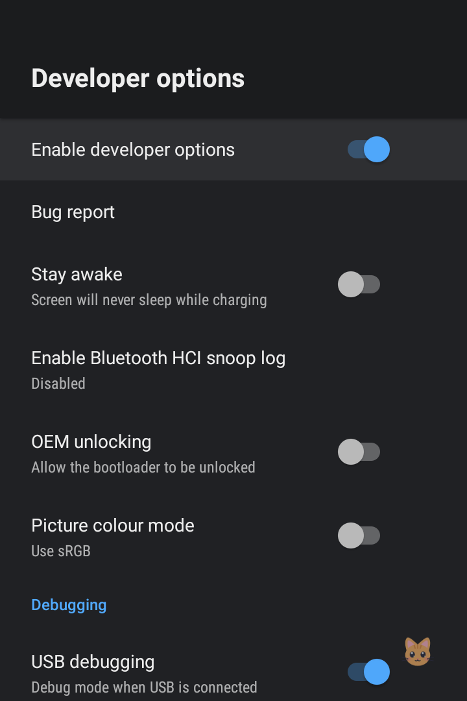
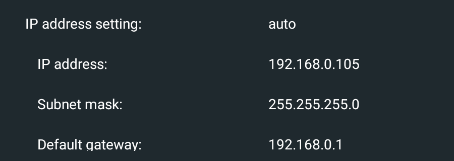

# hepta-tv-cat

[](LICENSE)

A tiny cat that sits in the corner of your Android TV and pops out a speech bubble every 30 minutes of continuous watching ("Yay! 30 min streak!", "Hmm. 1 h streak.", ...). The longer you watch, the grumpier the cat gets.

**Open source** under the [Apache License 2.0](LICENSE). Pure Java, no dependencies, one foreground service. Issues and pull requests are welcome.

<p align="center"></p>

- **Watching** = screen on and the foreground app is not the launcher.
- **Idle** = screen off or sitting on the home screen. 10 idle minutes (or TV standby) resets the streak.
- The streak survives restarts (saved every minute).
- The cat's face depends on the streak: happy under 1 h, unimpressed at 1 h, angry at 2 h, furious from 3 h.
- Every pop-up also shows the time, today's total, and time spent in the current app ("22:00 · 2 h today · 1 h 30 m on YouTube").
- Hourly chime: the cat pops the same status line at the top of every hour.
- Bedtime (optional): the cat yawns at the set hour and gets one mood grumpier for every hour past it.
- Nudges: 5 minutes on the home screen, volume above 80 % (50 % past bedtime), and a sticky "No internet!" while offline.
- Weather (opt-in): current temperature and sky in the bubble. Uses your public IP for location via geojs.io and open-meteo.com; off by default.
- TV notifications in the bubble (optional): needs one extra adb command, see step 7.
- Settings (click the app icon): show/hide cat, quiet mode (no pop-ups), weather, bedtime, cat size, transparency, corner position.

## Install (no Android Studio, no SDK)

You only need a computer on the **same Wi-Fi / router as the TV** and the small `adb` tool. Takes about 5 minutes.

Tested on a Sony BRAVIA (Android TV 11). It should work on any Android TV or Google TV running Android 8.0 or newer. Menu names differ a little between brands.

### 1. Check your Android version

On the TV: **Settings → Device Preferences → About**. Look for **Android TV OS version** (or "Android version"). It must be **8 or higher**.



### 2. Turn on Developer options

Still in **About**, scroll to **Android TV OS build** (on some TVs just **Build**) and press **OK / Select 7 times**. A message says you are now a developer.

### 3. Turn on debugging

Go back to **Settings → Device Preferences → Developer options** and switch on **USB debugging**. This is what lets the computer talk to the TV over Wi-Fi. (If your TV offers **Network debugging** or **Wireless debugging**, switch that on too. See Troubleshooting for the pairing variant.)



### 4. Find the TV's IP address

**Settings → Network & Internet →** your Wi-Fi network → **Network status** (on some TVs: *IP settings* or *About → Status*). Write down the **IP address**, for example `192.168.0.105`. Yours will differ.



> Tip: the first three numbers (`192.168.0`) must match your computer's. If they do not, the computer and TV are on different networks.

### 5. Install `adb` on your computer

`adb` is a ~10 MB command line tool from Google, not the whole Android Studio.

| OS | Command |
|---|---|
| macOS | `brew install android-platform-tools` |
| Windows | `winget install Google.PlatformTools` |
| Ubuntu/Debian | `sudo apt install adb` |
| Any | Download [SDK Platform-Tools](https://developer.android.com/tools/releases/platform-tools), unzip it, and run the commands from that folder |

Check it works: `adb version`.

### 6. Download the app

Download `hepta-tv-cat.apk` from the [latest release](https://github.com/heptafox/hepta-tv-cat/releases/latest).

### 7. Install on the TV

Replace `192.168.0.105` with your TV's IP address.

**Easy way**: download [`install.sh`](install.sh) next to the APK (macOS / Linux, or Git Bash on Windows) and run:

```sh
./install.sh 192.168.0.105
```

**Manual way** (works everywhere, including Windows PowerShell):

```sh
adb connect 192.168.0.105:5555
adb install -r hepta-tv-cat.apk
adb shell appops set dev.hepta.tvcat SYSTEM_ALERT_WINDOW allow   # draw the cat over other apps
adb shell appops set dev.hepta.tvcat GET_USAGE_STATS allow       # detect the foreground app
adb shell cmd notification allow_listener dev.hepta.tvcat/.NotifListener   # optional: TV notifications in the bubble
adb shell am start -n dev.hepta.tvcat/.SettingsActivity
```

The first time you connect, the **TV shows an "Allow USB debugging?" prompt**. Tick *Always allow* and choose **OK**, then run the command again if it failed.

The two `appops` lines are required: Android TV has no screen to grant these permissions, so you give them once from the computer. After that the computer is not needed any more.

### 8. Done

The cat appears in the corner and starts counting. The **TV Cat** icon is in your app list; click it to change settings. The cat also starts by itself after every TV reboot.

## Troubleshooting

- **`cannot connect to 192.168.0.105:5555`**: wrong IP, different network, or debugging is off. Re-check steps 3 and 4. Some TVs close the port after standby, so switch the debugging toggle off and on.
- **`unauthorized`**: look at the TV screen and accept the debugging prompt.
- **`more than one device/emulator`**: run `adb disconnect` first, then reconnect to the TV only.
- **Wireless debugging shows a pairing code (some Android 11+ TVs)**: run `adb pair <ip>:<pairing-port>` and enter the code, then `adb connect <ip>:<port>` using the port shown on the debugging screen, and use that address in the commands above.
- **Cat does not show**: the overlay permission was not granted. Run the two `appops` commands again.
- **Streak never resets / counts the home screen**: the usage-access permission is missing. Run the `GET_USAGE_STATS` command again.
- **Update fails with a signature error**: uninstall first (`adb uninstall dev.hepta.tvcat`) and install again.

To stop it: `adb shell am force-stop dev.hepta.tvcat`. To remove it: `adb uninstall dev.hepta.tvcat`.

## Build from source

Needs JDK 17+ and the Android SDK (platform 36). Gradle is downloaded by the wrapper.

```sh
export ANDROID_HOME=~/Library/Android/sdk   # your SDK path
./gradlew assembleDebug                      # -> app/build/outputs/apk/debug/app-debug.apk
java -ea app/src/main/java/dev/hepta/tvcat/Streak.java   # self-check for the streak logic
./install.sh <tv-ip> app/build/outputs/apk/debug/app-debug.apk
```

Pushing a tag like `v0.1` makes GitHub Actions build the APK and attach it to a release.

## Tuning

`Streak.java`: `MILESTONE_MIN` (30) and `IDLE_RESET_MIN` (10).
`CatService.java`: `SHOW_MS` (bubble on-screen time), `MIN_DP`/`MAX_DP` size range, `MAX_FADE` transparency cap, `LOUD_PCT`/`LOUD_LATE_PCT` volume warning, `HOME_NUDGE_MIN`, `BED_HOURS` choices.
Faces live in `res/drawable/face_*.xml`, layered over `cat_body.xml`.

## Contributing

Keep it small: Java only, no new dependencies, no layout XML. Run the self-check above before opening a pull request.

## License

Licensed under the [Apache License, Version 2.0](LICENSE). You may use, modify and redistribute it, including commercially, as long as you keep the license and notices.
